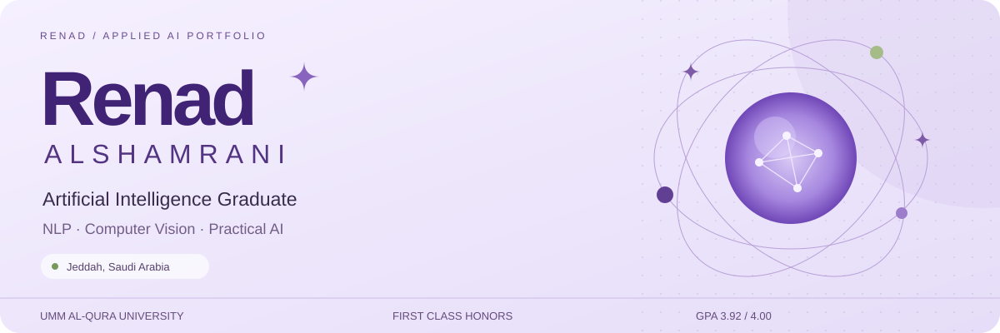
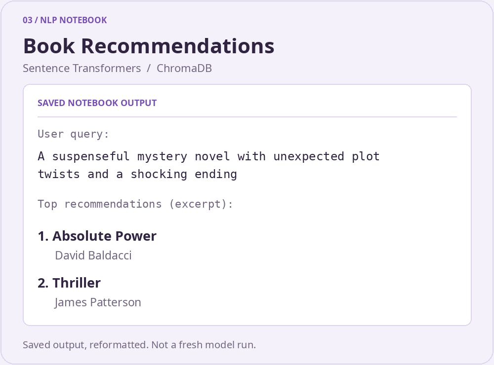
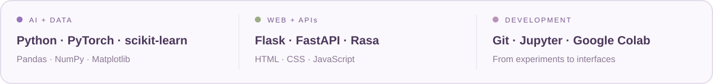

  

  <strong>From models to meaningful experiences.</strong>

  <a href="https://www.linkedin.com/in/renad-alshamrani/"><strong>LinkedIn</strong></a>
  &nbsp; · &nbsp;
  <a href="https://github.com/RenadShamrani?tab=repositories"><strong>Repositories</strong></a>

## Selected work

  <a href="https://github.com/RenadShamrani/LipStream"><strong>LipStream repository</strong></a>
  &nbsp; · &nbsp;
  <a href="https://github.com/RenadShamrani/LipStream/blob/main/LipStream-demo.mp4"><strong>Recorded demo</strong></a>

  
  

<strong>My contributions</strong>

- **LipStream:** Co-developed the PyTorch pipeline and built the Flask-connected web interface.
- **Haram Library Chatbot:** Co-developed the bilingual FAQ assistant and integrated its web interface.

## My toolkit

