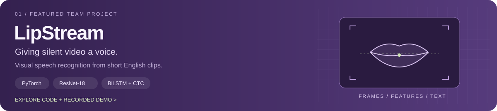
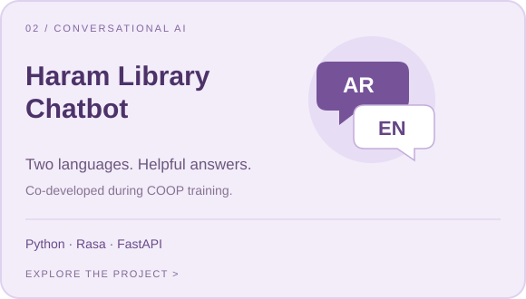
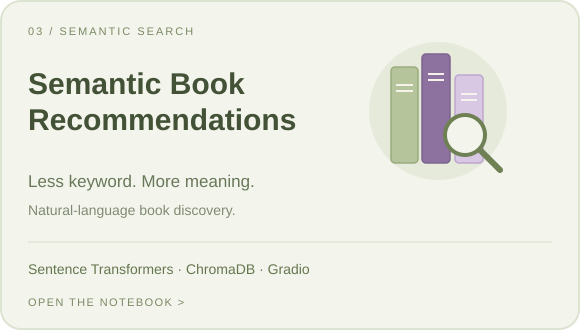

  

  <strong>From models to meaningful experiences.</strong> 
  I build AI projects across language, vision, and usable web interfaces.

  <a href="https://www.linkedin.com/in/renad-alshamrani/"><strong>LinkedIn</strong></a>
  &nbsp; · &nbsp;
  <a href="https://github.com/RenadShamrani?tab=repositories"><strong>Repositories</strong></a>
  &nbsp; · &nbsp;
  <a href="https://github.com/RenadShamrani/LipStream/blob/main/LipStream-demo.mp4"><strong>Recorded Demo</strong></a>

## Selected work

  
  

LipStream and the chatbot are collaborative projects. Team credits are preserved in their READMEs, including the <a href="https://github.com/loa24/LipStream">original LipStream repository</a>.

## My toolkit

<strong>A little more about my background</strong>

- **Education:** B.Sc. in Artificial Intelligence, Umm Al-Qura University, 2026. First Class Honors, GPA 3.92/4.00.
- **COOP:** NLP and chatbot development at Haram Library, March–July 2025. Co-developed an Arabic-English assistant covering 28 visitor FAQs and connected its backend to a web interface.
- **Career focus:** Entry-level AI engineering, machine learning, and Python development, with an interest in NLP and computer vision.

Language. Vision. Useful AI.

