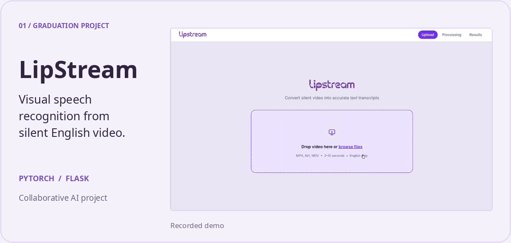
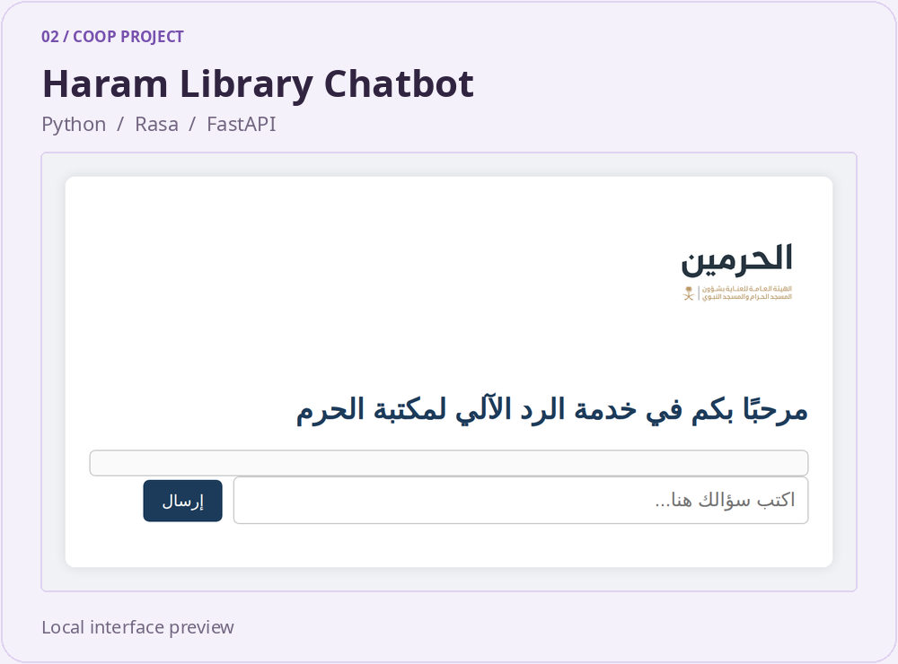

  

  <strong>From models to meaningful experiences.</strong> 
  AI graduate exploring language, vision, and usable interfaces.

  <a href="https://www.linkedin.com/in/renad-alshamrani/"><strong>LinkedIn</strong></a>
  &nbsp; · &nbsp;
  <a href="https://github.com/RenadShamrani?tab=repositories"><strong>Repositories</strong></a>
  &nbsp; · &nbsp;
  <a href="https://github.com/RenadShamrani/LipStream/blob/main/LipStream-demo.mp4"><strong>Recorded Demo</strong></a>

## Selected work

  <a href="https://github.com/RenadShamrani/LipStream"><strong>LipStream repository</strong></a>
  &nbsp; · &nbsp;
  <a href="https://github.com/RenadShamrani/LipStream/blob/main/LipStream-demo.mp4"><strong>Watch recorded demo</strong></a> 
  My role: co-developed the PyTorch pipeline and built the Flask-connected web interface.

  
  

<strong>Project details &amp; my contributions</strong>

- **LipStream:** Co-developed the Python/PyTorch pipeline, participated in GRID training and evaluation, and built the HTML/CSS/JavaScript interface integrated with Flask. The image comes from the [recorded demo](https://github.com/RenadShamrani/LipStream/blob/main/LipStream-demo.mp4), not a hosted app.
- **Haram Library Chatbot:** Co-developed the Arabic-English assistant, refined intents and dialogue around 28 FAQs, and integrated its web interface and notifications. The image shows the [original local UI](https://github.com/RenadShamrani/haram-library-chatbot/blob/main/app.py) only; it does not demonstrate the Rasa backend.
- **Semantic Book Recommendations:** NLP notebook for natural-language book discovery. The image reformats an excerpt of [committed notebook output](https://github.com/RenadShamrani/Semantic-Book-Recommendations/blob/main/semantic-book-recommendations.ipynb), not a fresh inference run.

LipStream and the chatbot are collaborative prototypes, not production deployments. Full credits, setup requirements, and limitations are in their READMEs, including the [original LipStream team repository](https://github.com/loa24/LipStream).

## My toolkit

<strong>A little more about my background</strong>

- **Education:** B.Sc. in Artificial Intelligence, Umm Al-Qura University, 2026. First Class Honors, GPA 3.92/4.00.
- **COOP:** NLP and chatbot development at Haram Library, March–July 2025. Co-developed an Arabic-English assistant covering 28 visitor FAQs and connected its backend to a web interface.
- **Career focus:** Entry-level AI engineering, machine learning, and Python development, with an interest in NLP and computer vision.

Language. Vision. Useful AI.

